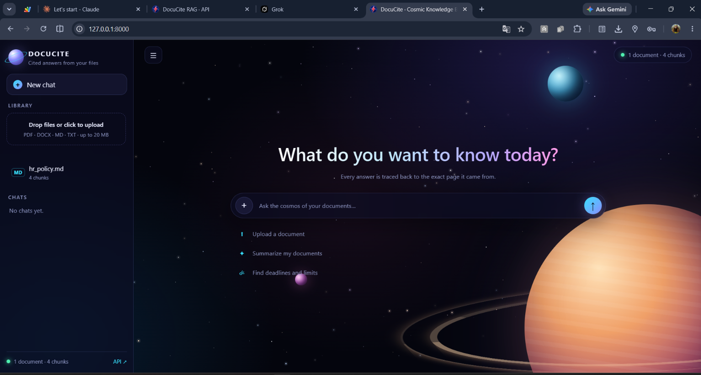

# DocuCite RAG
Document Q&A that answers **only from your uploaded files**, with strict citations (file + page/section).
If the documents don't contain the answer, it says so.



**Full documentation (architecture, modules, evaluation, problems solved): [docs/DOCUMENTATION.md](docs/DOCUMENTATION.md)**

| Evaluation (15 questions, real embeddings + Gemini 3.5 Flash Lite) | Result |
|---|---|
| Retrieval Recall@4 | 12/12 (100%) |
| Answer Faithfulness | 11/12 (92%), one miss caused by a faulty test keyword, see the docs |
| Correct abstention | 3/3 (100%) |

## Architecture
```
upload -> parser (PDF/DOCX/MD/TXT) -> chunker (500/80, page+section tags)
       -> SQLite (metadata, chunk ids) + FAISS (vectors, same ids)
ask    -> embed question -> FAISS top-k*3 -> hybrid rerank (0.7 vector + 0.3 keyword)
       -> min_score filter -> LLM with strict cite-or-NO_ANSWER prompt -> answer + citations
```

## Setup
```bash
python -m venv .venv && source .venv/bin/activate     # Windows: .venv\Scripts\activate
pip install -r requirements.txt
cp .env.example .env        # put your LLM_API_KEY inside
uvicorn app.main:app --reload
```
Swagger UI: http://127.0.0.1:8000/docs

No API key? The app still works in **extractive mode** (returns the best cited passage, no LLM).
No internet for the embedding model? Set `EMBEDDING_BACKEND=hash` (keyword-style, for demos/tests only).

## API examples
```bash
curl -X POST http://127.0.0.1:8000/api/v1/documents/upload -F "file=@policy_2026.pdf"
curl http://127.0.0.1:8000/api/v1/documents
curl -X POST http://127.0.0.1:8000/api/v1/chat/ask \
     -H "Content-Type: application/json" \
     -d '{"question": "How many vacation days do employees get?"}'
curl -X DELETE http://127.0.0.1:8000/api/v1/documents/1
curl http://127.0.0.1:8000/api/v1/health
curl -X POST http://127.0.0.1:8000/api/v1/admin/reindex   # after changing EMBEDDING_MODEL
```
Example answer:
```json
{
  "answer": "Every employee receives 24 vacation days per year [1].",
  "answerable": true,
  "mode": "llm",
  "citations": [{"source_id": 1, "label": "policy_2026.pdf, p. 4", "filename": "policy_2026.pdf",
                 "page": 4, "section": null, "snippet": "...", "score": 0.81}]
}
```

## Tests & evaluation
```bash
pytest                                  # 20 unit/API tests
python -m tests.eval_rag --offline      # retrieval only, no LLM quota used
python -m tests.eval_rag                # full run with the LLM (uses ~15 requests)
```

## Security
- By default `uvicorn app.main:app` listens on `127.0.0.1` only, so only your own computer can open the UI and `/docs`.
- Before exposing the server (`--host 0.0.0.0`, a tunnel, a deployment) set in `.env`:
  `ACCESS_KEY=<long random string>` (all `/api/v1/*` calls then need the `X-API-Key` header; the UI asks for the key once)
  and `ENABLE_DOCS=false` (hides `/docs`, `/redoc` and `/openapi.json`).
- Never commit `.env` (it is in `.gitignore`).

## Source viewer
Click a source card (or a file in the Library) to open the indexed passages of that document in a side panel,
with the cited passage highlighted.

## Design decisions
- `chunks.id` is also the FAISS id, so deletes stay perfectly in sync (`/health` reports drift).
- Hybrid scoring + `MIN_SCORE` threshold prevents answering from irrelevant passages.
- The LLM must answer `NO_ANSWER` when context is insufficient; answers without valid `[n]` citations fall back to returning all retrieved passages.
- DOCX has no real pages, so its citations use the section heading.

## Known limitations
- Scanned/image PDFs have no text layer (OCR not included).
- Brute-force FAISS index (`IndexFlatIP`): fine up to ~100k chunks.
- No authentication; add it before exposing publicly.
