# DocuCite RAG: Project Documentation

> A knowledge base that answers questions **only from your own documents** and shows **exactly where** each answer came from (file, page or section). If the documents do not contain the answer, it says so instead of inventing one.

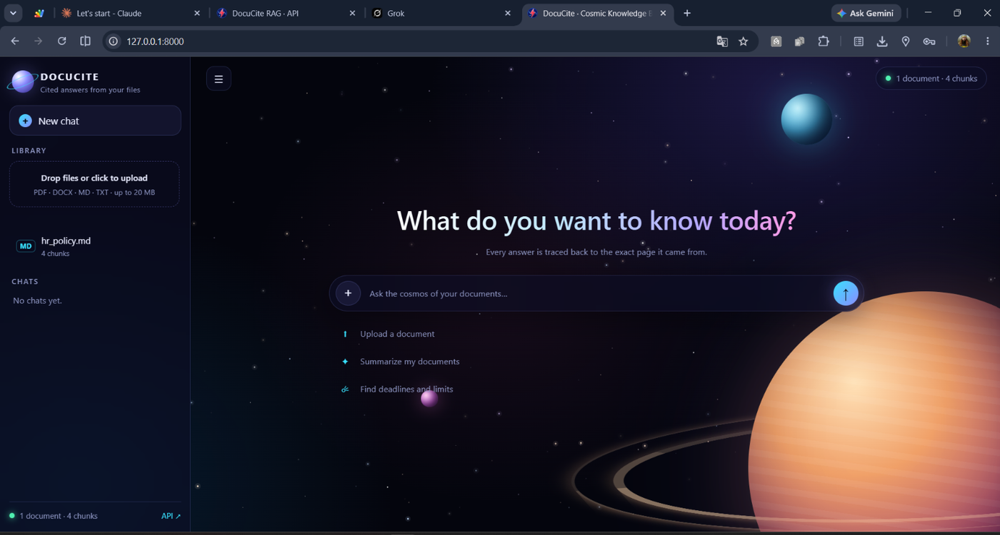

---

## 1. What problem does it solve?

Ordinary chatbots answer from memory, so they can confidently make things up (*hallucination*). DocuCite RAG is built for cases where a wrong answer is costly: internal manuals, policies, exam rules, SDK documentation.

| Use case | Example |
|---|---|
| Engineering / robotics teams | "What does error code E101 mean?" answered from the device manual |
| Universities and students | "How many times can I retake the exam?" answered from the official rules |
| Support and HR | Staff answers based on internal regulations, delivered through the REST API |

## 2. Key features

1. **Strict citations.** Every answer carries numbered sources (`[1]`) that point to the file and page or section. Clicking a source opens the document passages in a side panel with the cited passage highlighted.
2. **Refuses when it doesn't know.** Weak matches are filtered out before the model is called; the model itself must reply `NO_ANSWER` when the context is insufficient.
3. **Smart chunking.** 500-character chunks with 80-character overlap, cut at paragraph or sentence boundaries, tagged with page or section.
4. **Hybrid retrieval.** Multilingual embeddings (FAISS) plus keyword overlap re-ranking.
5. **Built-in evaluation.** A script measures Retrieval Recall, Answer Faithfulness and correct abstention on 15 questions.
6. **Resilient LLM layer.** Automatic retries on server errors, clear rate-limit handling, and fallback models.
7. **Optional protection.** Access key and the option to hide the API docs, for when the server is shared.
8. **Web UI.** Space-themed interface with drag-and-drop upload, chat history, source viewer and a status indicator.

## 3. Architecture

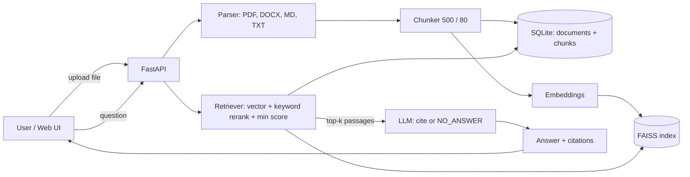

**Technology stack:** Python, FastAPI, SQLite, FAISS, Sentence-Transformers (`paraphrase-multilingual-MiniLM-L12-v2`), any OpenAI-compatible LLM API (tested with Gemini), Pydantic, Pytest, plain HTML/CSS/JS for the UI.

### Project structure

```text
docucite-rag/
├── app/
│   ├── main.py            # FastAPI app, routes, docs switch
│   ├── config.py          # settings from .env
│   ├── schemas.py         # request/response models
│   ├── database.py        # SQLite: documents and chunks
│   ├── security.py        # optional access key
│   ├── api/               # documents.py, chat.py
│   ├── services/          # parser, chunker, vector_store, ingestion, rag_engine
│   └── static/            # index.html (UI), favicon.svg
├── data/                  # uploads and index (git-ignored)
├── tests/                 # unit/API tests and eval_rag.py + eval_data/
├── docs/                  # this documentation
├── .env.example
└── requirements.txt
```

## 4. How each module works

### 4.1 Parser (`services/parser.py`)
- **PDF** is read page by page, so citations carry real page numbers.
- **DOCX and Markdown** are split by headings; the heading becomes the citation label (Word files have no fixed pages).
- **TXT** tries several encodings (UTF-8, UTF-16, cp1251) so Cyrillic files open correctly.
- Empty files, scanned image PDFs and password-protected PDFs raise a clear error instead of failing silently.

### 4.2 Chunker (`services/chunker.py`)
Splits text into overlapping chunks and prefers to cut at a paragraph or sentence end. The overlap keeps a sentence from being cut off from its context. Page and section tags are kept on every chunk.

### 4.3 Vector store (`services/vector_store.py`)
- Chunks are embedded with a multilingual model (useful for Kazakh, Russian and English documents) and stored in FAISS (cosine similarity).
- The **chunk ID in SQLite is the same ID used in FAISS**, so deleting a document removes exactly its vectors.
- The index is saved to disk atomically; it survives restarts. `/health` reports whether the index and the database are in sync, and `/admin/reindex` rebuilds the index.

### 4.4 RAG engine (`services/rag_engine.py`)
1. Search FAISS for `k × 3` candidates.
2. **Hybrid score** = `0.7 × vector similarity + 0.3 × keyword overlap`.
3. Drop everything below `MIN_SCORE`. If nothing is left, answer "not found" **without calling the LLM**.
4. Build a numbered context and call the LLM with a strict system prompt: use only the context, cite `[n]` after each fact, reply `NO_ANSWER` if unsure, temperature 0.
5. Return the answer with only the sources the model actually cited, each with file, page or section, a snippet, a relevance score, and the document and chunk IDs for the viewer.

**Without an API key** the engine switches to *extractive mode* and returns the best matching passage with its citation, so the app still works offline.

### 4.5 LLM reliability
- Retries `500/502/503/504` up to 3 times with 1 s, 2 s, 4 s waits.
- Quota errors (`429`) are not retried blindly; they return a clear message to the UI.
- `LLM_FALLBACK_MODELS` lists backup models. Each model has its own quota, so if the main one is overloaded or exhausted the next one is tried automatically.

### 4.6 REST API

| Method | Endpoint | Purpose |
|---|---|---|
| POST | `/api/v1/documents/upload` | Upload and index a document |
| GET | `/api/v1/documents` | List documents |
| GET | `/api/v1/documents/{id}/chunks` | Indexed passages of one document |
| DELETE | `/api/v1/documents/{id}` | Delete a document and its vectors |
| POST | `/api/v1/chat/ask` | Ask a question, get answer plus citations |
| POST | `/api/v1/admin/reindex` | Rebuild the vector index |
| GET | `/api/v1/health` | Index and database status |

Uploads are validated: allowed extensions only, 20 MB limit, empty files rejected, file names sanitized.

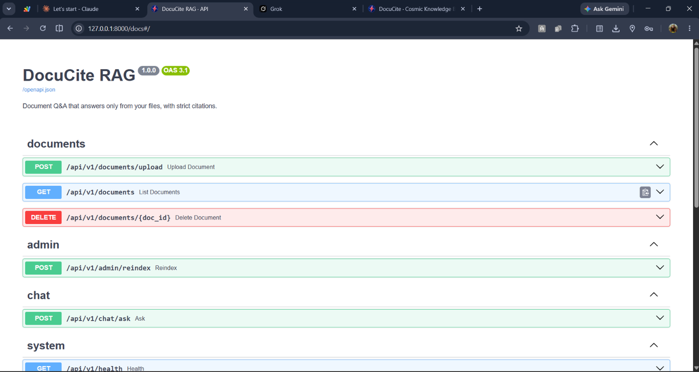

### 4.7 Security
By default the server listens on `127.0.0.1`, so only the local computer can open it. Before sharing or deploying, set `ACCESS_KEY` (all `/api/v1` calls then require an `X-API-Key` header; the UI asks for the key once) and `ENABLE_DOCS=false` (hides `/docs`, `/redoc`, `/openapi.json`). `.env` is git-ignored.

### 4.8 Web UI
Drag-and-drop upload, document library, chat history saved in the browser, clickable sources that open a side panel with the cited passage highlighted, a live index status indicator, responsive layout, and reduced-motion support.

## 5. Demonstration

**Upload and indexing**: a Markdown file is parsed, split into chunks and indexed (`201 Created`).

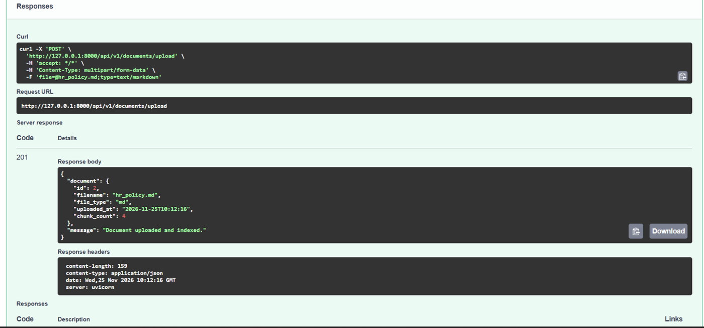

**Health check**: the vector index and the database agree (4 chunks, 4 vectors).

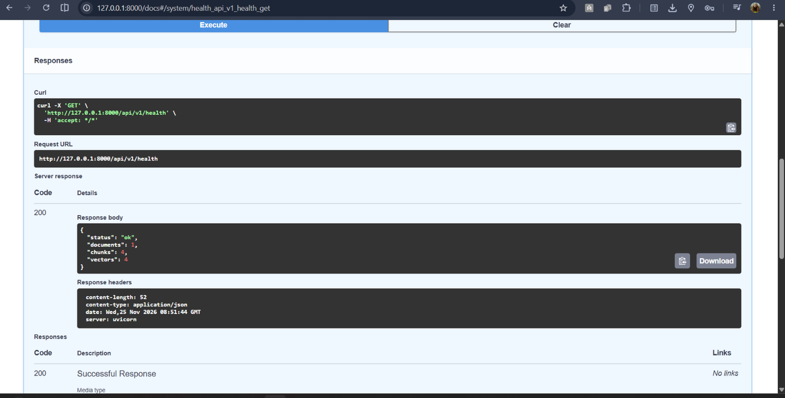

**A question that is not in the documents**: the system refuses instead of inventing an answer.

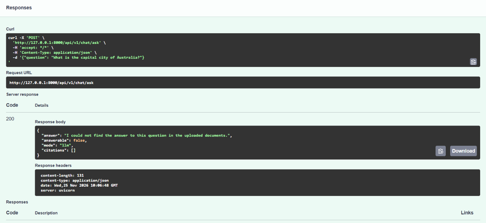

## 6. Testing and evaluation

### Automated tests
**27 tests** (chunker, parser, vector store persistence, every API endpoint, access key, rate-limit handling, fallback models). They run offline with a lightweight embedder and a mocked LLM.

### Evaluation pipeline (`tests/eval_rag.py`)
15 questions over three small documents (a robot manual, an HR policy, exam rules): 12 answerable questions and 3 that are not in the documents. The run below used the real embedding model and a real LLM (Gemini 3.5 Flash Lite, free tier).

| Metric | Result |
|---|---|
| Retrieval Recall@4 (right passage found) | **12 / 12 (100%)** |
| Answer Faithfulness (correct answer, right source cited) | **11 / 12 (92%)** |
| Correct abstention (refused when not in documents) | **3 / 3 (100%)** |

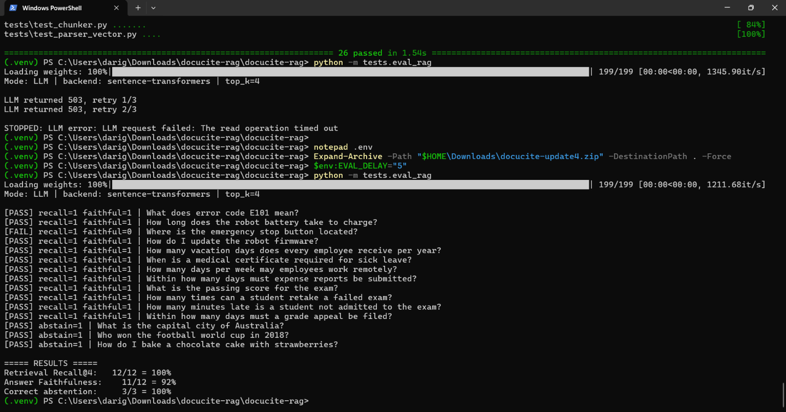

**About the one miss.** The failing question was *"Where is the emergency stop button located?"*. The expected keyword in my test set described the button's colour (`red button`) instead of its location, so a correct answer such as "on the top back of the robot" would be marked wrong. I could not inspect the model's actual reply in that run, so this is the most likely cause, not a confirmed one. The keyword was corrected to `top back` and the script now prints the real answer for any failing question; a re-run with the corrected set is pending.

**Limits of this evaluation.** It uses 15 questions over 3 short synthetic documents with keyword matching. It checks that the pipeline behaves correctly, but it is not a benchmark of real-world accuracy.

Run it yourself:
```bash
python -m tests.eval_rag --offline   # retrieval only, no LLM quota used
python -m tests.eval_rag             # full run with the LLM (about 12 requests)
```

## 7. How it was built

The project was developed with **AI assistance (Claude)** as a pair-programming partner. The author ran every step locally, tested on real hardware, chose the LLM provider and model, diagnosed errors from the terminal and browser, and published the repository.

| Stage | What happened |
|---|---|
| Design | Requirements and architecture defined in a project brief (strict citations, evaluation, clean structure) |
| Core pipeline | Parser, chunker, SQLite metadata, FAISS vector store, ingestion |
| API and RAG engine | Upload, list, delete, chat endpoints; cite-or-refuse prompt; hybrid retrieval |
| Verification | Unit and API tests; first server start on **25 Nov 2026 at 13:34** (local time) |
| LLM integration | Connected Gemini through its OpenAI-compatible endpoint; hit overload and quota limits (see section 8) |
| UI | Web interface, space theme, favicon, chat history, source viewer |
| Hardening | Optional access key, docs switch, retries, fallback models |
| Evaluation and release | Evaluation run, model selection by quota, GitHub publication on **27 Nov 2026** |

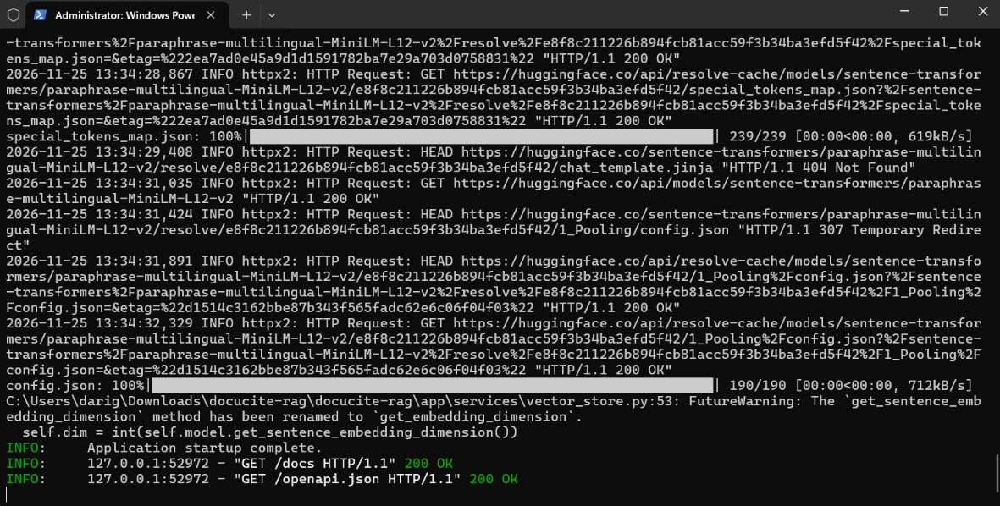

**Time spent.** Two working sessions, on 25 and 27 November 2026, against an original plan of five days / 30 Pomodoros. These dates come from log and screenshot timestamps; the exact number of hours was not tracked.

## 8. Problems met and how they were solved

| Problem | Cause | Solution |
|---|---|---|
| `503 Service Unavailable` from the LLM | Provider temporarily overloaded | Automatic retries with backoff; fallback models |
| `429 Too Many Requests` | Free tier allowed only 20 requests per day on the first model | Added a clear rate-limit error; chose a lighter model with a much larger daily quota; throttled the evaluation script |
| Tests failed with `PermissionError` on Windows | Temp folder created earlier by an administrator terminal | Configured pytest to use a project-local temp folder |
| `$env:LLM_API_KEY=""` did not disable the LLM | PowerShell deletes an empty environment variable, so the key from `.env` was used | Added an `--offline` flag to the evaluation script |
| Duplicate documents after repeated uploads | No duplicate check | Documented; documents can be removed in the UI (a duplicate filter is a possible improvement) |

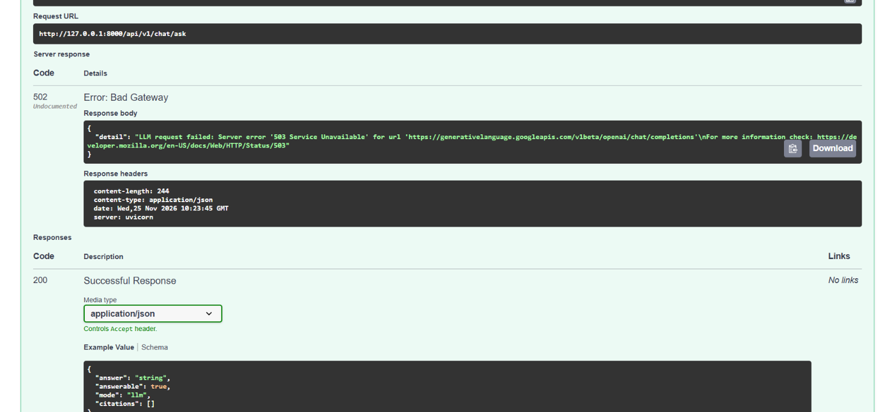
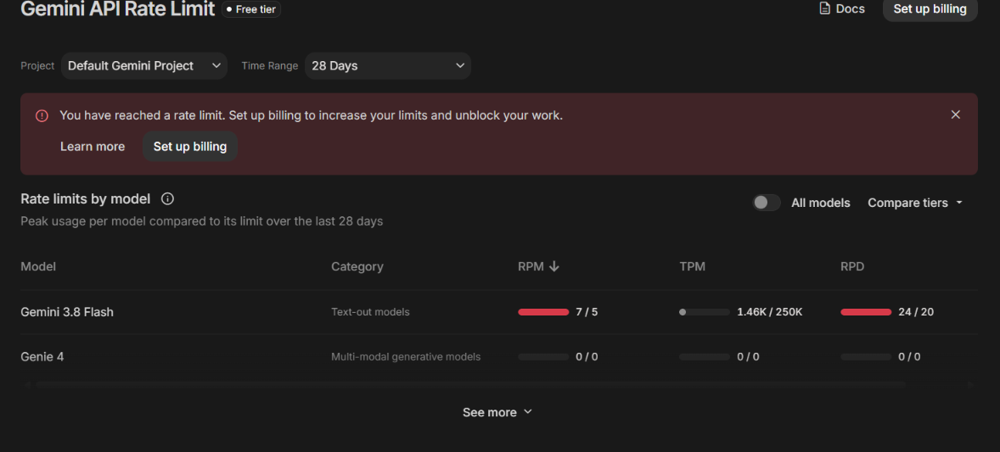
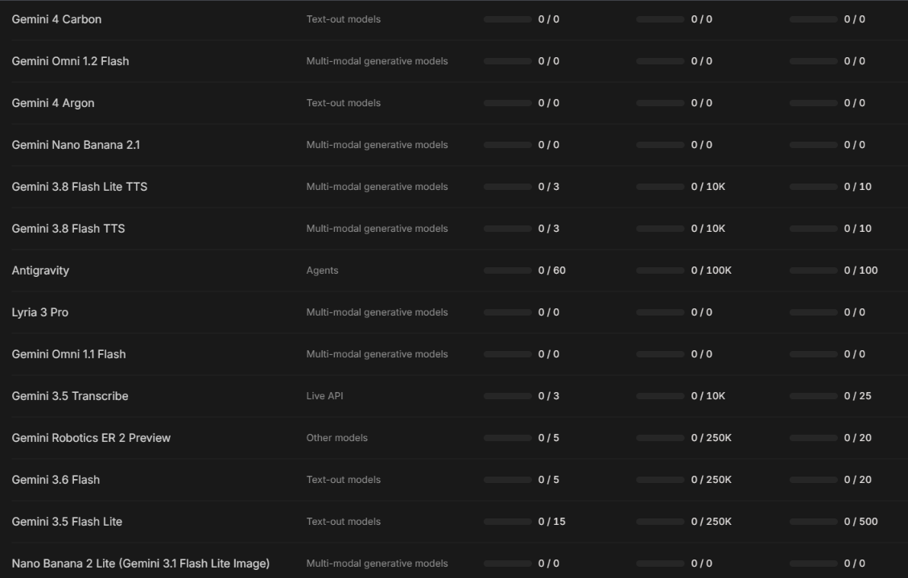
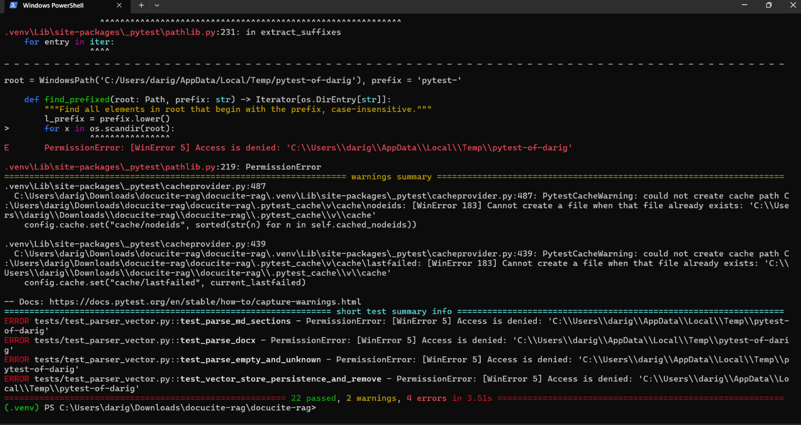

## 9. Publication

The repository was checked before committing: secrets (`.env`), the virtual environment and uploaded files are not tracked.

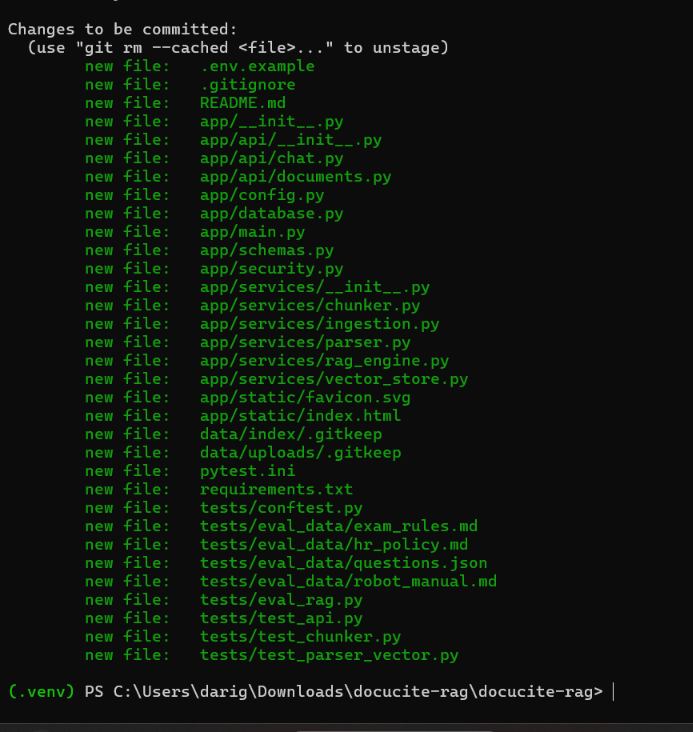
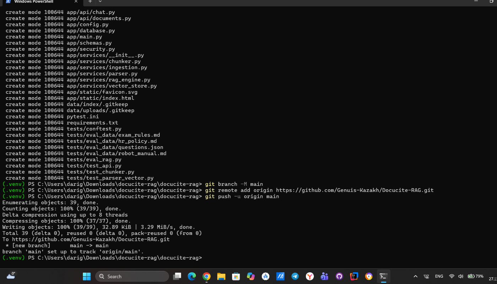

## 10. Limitations and future work

- Scanned PDFs (images) are not supported yet; OCR would fix this.
- The index is a brute-force FAISS index: fine for tens of thousands of chunks, not for millions.
- The side panel shows indexed text passages, not the original PDF page.
- No user accounts: one shared knowledge base, protected by one optional key.
- Evaluation is small. Next steps: a larger real-document test set, a cross-encoder re-ranker, BM25 hybrid search, streaming answers, duplicate-upload detection, and re-running the evaluation with other providers (for example OpenAI).

## 11. Quick start

```bash
python -m venv .venv && source .venv/bin/activate     # Windows: .venv\Scripts\activate
pip install -r requirements.txt
cp .env.example .env                                  # add your LLM key
uvicorn app.main:app --reload
# open http://127.0.0.1:8000/
```
